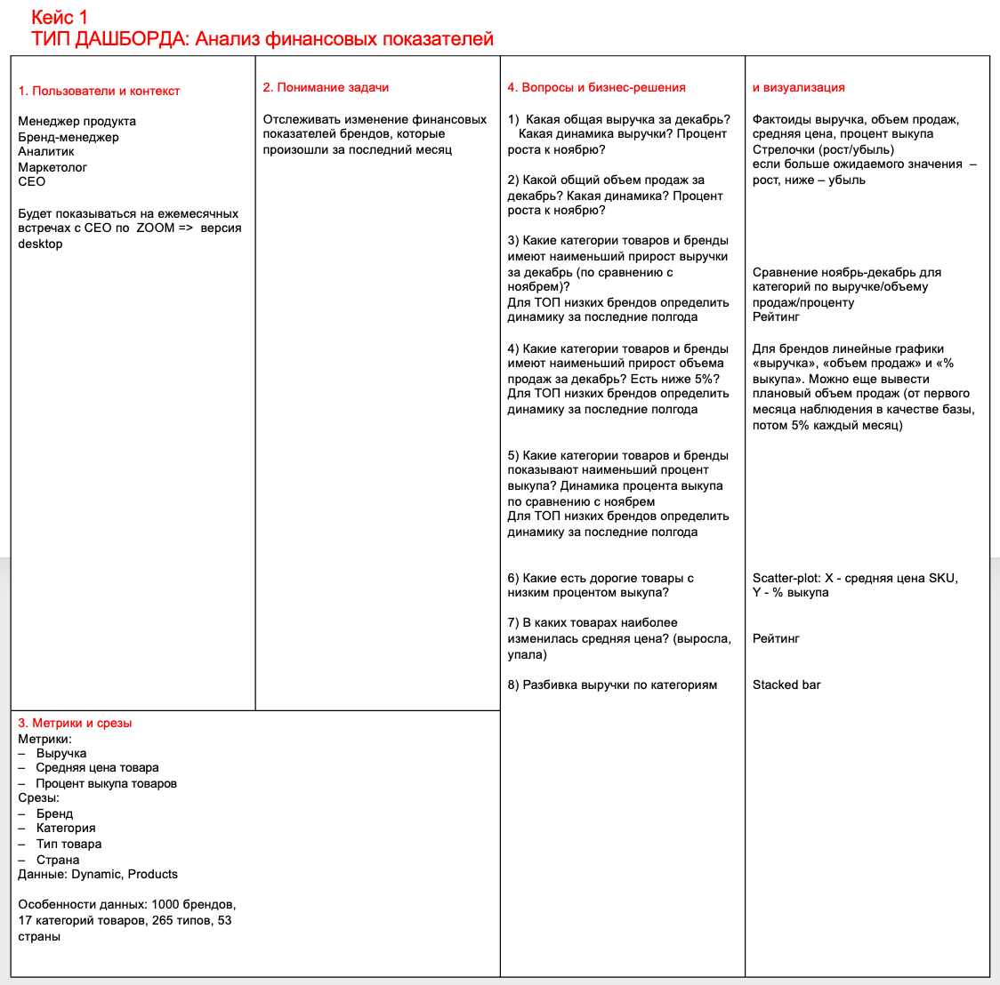

# Дашборд финансовых показателей маркетплейса

## Описание проекта

Разработан дашборд в Yandex DataLens для анализа финансовых показателей маркетплейса в сфере красоты.

**Цель проекта** - отслеживать изменения ключевых финансовых показателей, оценивать эффективность продаж и выявлять проблемные категории и бренды.

## Этапы работы

- Определены основные метрики: выручка, количество продаж, средняя цена товара и процент выкупа.
- Настроено сравнение показателей с предыдущим месяцем для оценки динамики продаж.
- Добавлены фильтры по брендам, категориям, типам товаров и странам.
- Реализовано отслеживание целевых показателей: рост выручки на 5% месяц к месяцу и процент выкупа не ниже 95%.
- Созданы графики и таблицы для анализа финансовых показателей в разных разрезах.

## Результат

С помощью дашборда можно:

- Определять категории и бренды с наибольшим падением выручки.
- Находить бренды с низкими продажами и процентом выкупа.
- Выявлять дорогие товары с низким процентом выкупа.
- Отслеживать выполнение плановых показателей по выручке и проценту выкупа.
- Принимать решения об изменении ассортимента и запуске маркетинговых акций.

Дашборд упрощает регулярный анализ финансовых показателей и помогает принимать решения на основе данных.

**ДАШБОРД**:
https://datalens.yandex/0w0kp2aom2ual

**Dashboard Canvas**:

